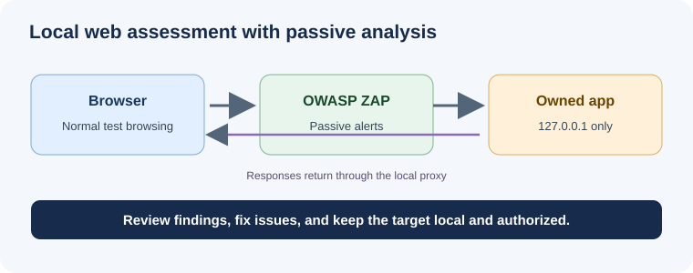

# Experiment 6: Defensive Web Assessment with OWASP ZAP

## Aim

To use OWASP ZAP's passive analysis to review a web application running locally and document findings with appropriate remediation.

> **Illustration:** Original schematic, not a screenshot of a completed lab run.

## Scope and Safety

Scan only an application you own or have explicit permission to assess. Keep the target on the local machine (for example, `http://127.0.0.1:3000`) and use passive scanning only. Do not scan public websites or third-party systems.

## Tools

- OWASP ZAP
- A locally running application that you own or are authorized to test

## Procedure

1. Start the authorized application locally and confirm it is reachable from your browser.
2. Open OWASP ZAP and choose **Manual Explore** or the equivalent option for browsing through the local proxy.
3. Set the target to the local application only. Confirm the host is `127.0.0.1` or `localhost` and the expected local port before proceeding.
4. Browse a small set of normal application pages using non-sensitive test data. Do not submit real credentials or personal information.
5. Review the **Alerts** tab for passive findings. For each item, record its risk, affected local URL, evidence, and a practical remediation.
6. Verify the app remains in scope throughout the session. Stop browsing and scanning if ZAP shows a host other than the authorized local target.

## Results Table

| Finding | Risk | Local URL or component | Recommended remediation |
|---|---|---|---|
| | | | |

## Result

The local application was reviewed using ZAP's passive analysis, and observations were recorded with remediation advice. No active attack scan or public target was used.

## Conclusion

Passive web assessment helps identify security configuration and content issues while normal pages are being browsed. Findings should be validated and fixed by the application owner.
