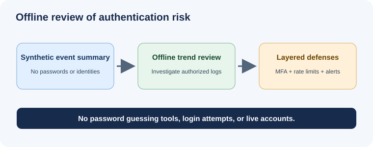

# Experiment 9: Password-Guessing Risk and Authentication Defenses

## Aim

To evaluate a fictional set of authentication events and propose controls that reduce password-guessing risk without attempting logins or testing real accounts.

> **Illustration:** Original schematic, not a screenshot of a completed lab run.

## Scope and Safety

This is an offline analysis exercise. Do not use Hydra or other password-guessing tools, submit login attempts, or test real accounts. The synthetic events below contain no passwords, account names, or identifying information.

## Synthetic Event Summary

| Interval | Failed sign-ins | Distinct fictional accounts | Successful sign-ins after failures |
|---|---:|---:|---:|
| 10:00–10:05 | 18 | 6 | 0 |
| 10:05–10:10 | 24 | 8 | 0 |
| 10:10–10:15 | 3 | 2 | 1 |

## Procedure

1. Review the synthetic event summary and identify patterns that warrant investigation.
2. Explain which conclusions cannot be drawn from these aggregate data alone. Do not infer a real source, user, or password.
3. Propose layered controls: multi-factor authentication, rate limiting, progressive delays, breached-password screening at enrollment, secure password reset, and alerting for unusual failure rates.
4. Discuss how to avoid account lockout policies becoming a denial-of-service risk. Include safe recovery and support procedures.
5. Draft a short incident-response checklist for an administrator who receives a similar alert: validate the alert, review authorized logs, protect affected accounts, and document actions.

## Analysis

| Question | Response |
|---|---|
| Which interval has the highest number of failures? | |
| What follow-up evidence should an authorized administrator review? | |
| Which controls would reduce risk without exposing users to avoidable lockouts? | |
| What information should be excluded from a student report? | |

## Result

The synthetic events were analyzed and a set of defensive recommendations was documented without attempting authentication or guessing passwords.

## Conclusion

Rate limiting, multi-factor authentication, secure recovery, and privacy-conscious monitoring help reduce password-guessing risk. Defensive analysis should rely on authorized logs and avoid testing live accounts.
